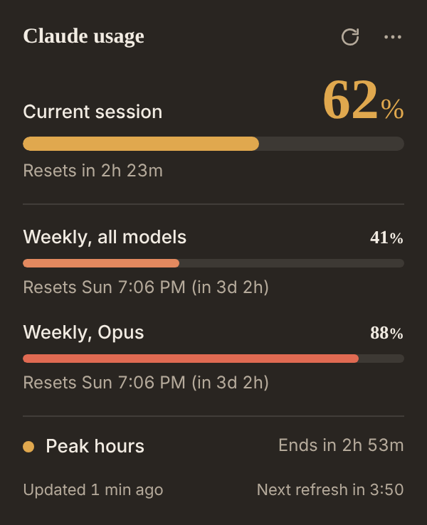
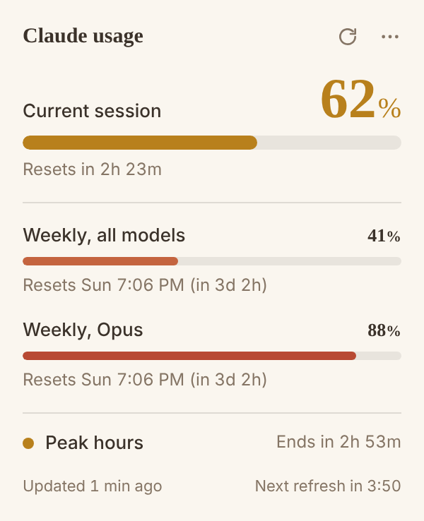

# Chrome extension

The same meter as the desktop widget, in the browser toolbar. Click the toolbar icon and the
panel drops down under it; click anywhere else and it closes, the way every Chrome popup does.

<p>
  
  
</p>

It lives in [`extension/`](../extension) and works in Chrome, Edge, Brave and other
Chromium browsers (Manifest V3, Chrome 116 or newer).

## Install it

It isn't in the Chrome Web Store yet, so load it from this repository:

1. Clone or download this repository.
2. Open `chrome://extensions` and turn on **Developer mode** (top right).
3. Click **Load unpacked** and choose the `extension` folder.
4. Pin **Usage Meter for Claude** to the toolbar, and click it.

## Signing in

There is no separate sign-in. The extension reads your usage with the claude.ai session that
is already in your browser, so if you're signed in to claude.ai in a tab, the popup works. If
you're not, it offers to open claude.ai; sign in there and click refresh.

This is the one real difference from the desktop app, which keeps a browser profile of its own.

## What it shows

Exactly what the widget shows, in the same layout:

- **Current session** (the 5-hour window), large, with the time until it resets.
- **Weekly limits**, one bar each, with their reset day and countdown.
- **Peak hours** and a countdown to the next change, in your local time.
- A footer with when the numbers were last updated and when the next refresh is due.

The toolbar icon also carries your session percentage as a badge, so you can see it without
opening the popup. Turn it off in Settings → General.

## Free plans

claude.ai answers the usage endpoint for a Free account, but puts nothing in it: every
bucket null and an empty list. That is not a permissions problem and no amount of polling
will produce a number — on Free there is simply nothing behind that endpoint.

The figures do exist, in the chat itself. Each reply carries a `message_limit` event with a
`windows` map holding the 5-hour and weekly utilization and their reset times, and claude.ai
keeps sending it on Free. Reading it means watching a reply arrive, so **Settings → General →
Read Free plan usage from claude.ai** registers a small reader in your claude.ai tabs. It is
off by default, and Pro, Max, Team and Enterprise accounts never need it.

What that reader does, and doesn't:

- It wraps `fetch` on the page and reads a *clone* of the reply, so claude.ai consumes its
  own stream exactly as it would have. It changes no request, no response and nothing on the
  page, and sends only the usage numbers to the extension.
- It is registered at runtime, so turning the setting off removes it from the page rather
  than leaving it there idle.
- Usage appears after your next message, not before. A fresh install shows nothing until you
  chat, and the numbers are as fresh as your last reply — the popup says so under the bars.
- The last reading is kept per organization and survives restarts, so the popup has
  something to show when you open it.

Two known gaps. Accounts served by claude.ai's newer binary chat transport never make the
request this reads, so they will see nothing. And the desktop widget cannot do any of this:
there is no claude.ai page for it to watch, so Free support is the one thing the extension
has and the widget does not.

## Pace, and the size of a chat

Hovering a reading on the strip says how fast it is going: *"Using about 12% an hour — about
2h to 100% at this pace."* The pace comes from readings kept over the last few hours, per
limit and per window, so a reset starts the measurement again rather than averaging across
it. Until there are a few minutes of readings it says so instead of guessing, and a limit
that has not moved says that too. The same line is the popup's tooltip on each bar.

The strip can also show the size of the conversation you have open — `Chat ~12k tokens`,
with the split between what you sent and what came back on hover. claude.ai publishes no
token count for a chat, so this is measured from the text itself at roughly four characters
a token: an estimate, always shown with a `~`, and it counts text only, not images or files.
Turn it off with **Chat size** in the gear menu.

## Settings

The strip carries its own: the **gear** on it opens a short menu for what it shows — session,
weekly, peak hours, each reset time, and the bars — which is what people reach for while
looking at it. Changes apply at once and follow you to every claude.ai tab.

**Advanced settings…** at the bottom of that menu opens the full page, which is also where
right-click the toolbar icon → **Options** and the popup's `⋯` menu go.

- **General:** refresh interval (1 to 30 minutes), peak hours, the toolbar badge, and
  reading Free plan usage from claude.ai (see above).
- **Appearance:** style (Classic or Cozy), theme (System, Dark or Light), accent colour, size,
  and custom CSS. The strip follows all of it, except that on System it takes claude.ai's own
  theme rather than the computer's, so it can't end up light on a dark page.
- **Account:** which organization to show, if your account has more than one.
- **About:** version and a link to this repository.

Settings are stored with `chrome.storage.sync`, so they follow your Chrome profile to your
other computers. The usage it last read is kept locally and is never synced.

## How it works

| Piece | What it does |
| --- | --- |
| `manifest.json` | Manifest V3. Asks only for `storage`, `alarms`, `scripting` and `https://claude.ai/*`. |
| `background.js` | Service worker: owns the settings, fetches usage from claude.ai, keeps the countdown with `chrome.alarms`, paints the badge, and keeps what the page reader hears. |
| `claude-page.js` / `claude-bridge.js` | The Free plan reader, registered only while that setting is on: one half in the page's world to read the reply stream, one in ours to carry the numbers back. |
| `popup.html` / `popup.js` / `popup.css` | The panel itself, the same markup and styles as the desktop widget. |
| `options.html` / `options.js` / `options.css` | The Settings page, the same controls as the desktop Settings window. |
| `shared/core.js` | A copy of [`src/shared/core.js`](../src/shared/core.js): usage parsing, peak hours, formatting, thresholds. |

The popup is only a view. It asks the service worker for whatever state it already has the
moment it opens, so it draws instantly even when the worker was asleep, and a refresh runs
behind it if the numbers are older than one interval.

### Keeping the shared logic in sync

`extension/shared/core.js` is a byte-for-byte copy of `src/shared/core.js`, because an
extension can only load files inside its own folder. After changing the shared logic:

```bash
npm run sync:extension
npm test
```

`test/extension.test.js` fails if the copy has drifted, if the manifest version doesn't match
`package.json`, or if a file the manifest or the pages point at is missing.

## Privacy

The extension talks to claude.ai and nothing else, and reads only your organizations and your
usage. Nothing is sent anywhere, there is no analytics, and the usage it reads stays on your
computer. See [PRIVACY.md](../PRIVACY.md).
